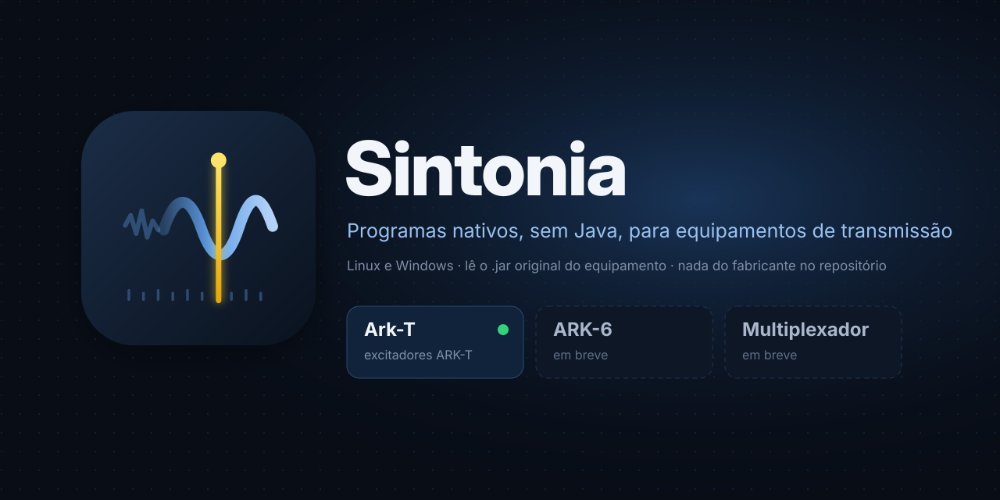
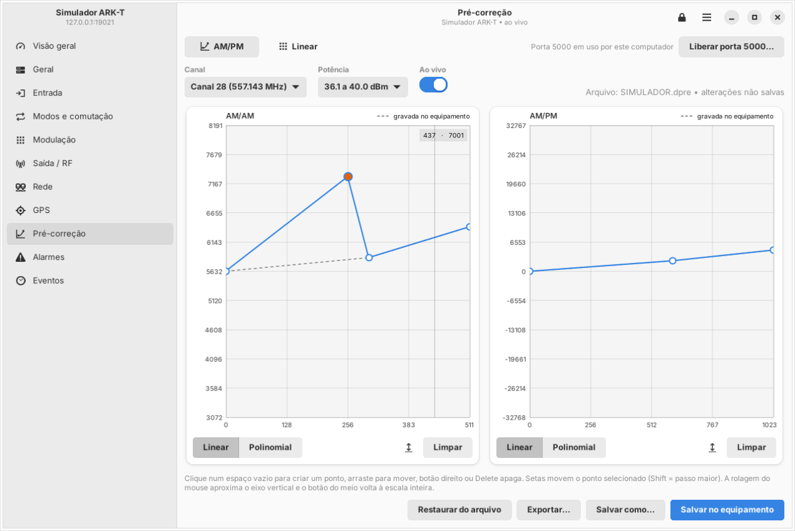

<p align="center">
  
</p>

<p align="center">
  
  
  
  
  
  
</p>

**Sintonia** é uma coleção de programas nativos para gerenciar **equipamentos de transmissão de TV e rádio** cujo software de fábrica é um applet ou programa **Java** antigo. Cada app reescreve um desses programas como um aplicativo de verdade para **Linux e Windows**: mesma comunicação com o equipamento, telas em português, modo edição com confirmação, simulador para treinar e pacotes `.deb` e `.exe` prontos.

O problema é sempre o mesmo. Excitadores, multiplexadores e afins chegaram com um `.jar` de mais de dez anos que só roda num Java antigo, abre com avisos de segurança e não evolui. Nos computadores de hoje, em especial no Linux, abrir a gerência de um transmissor vira um trabalho à parte. O Sintonia coloca esses equipamentos de volta "em sintonia" com o computador de hoje.

---

## Apps

| App | Equipamento | Situação | Pacotes |
|---|---|---|---|
| **[Ark-T](ark-t)** | excitadores **ARK-T** ISDB-T e DVB-T (MB International / Screen Service) - substitui o *ARK-T Installer Utility 5.5* |  | [`.deb`, instalador e portátil do Windows](https://github.com/aragonxpd154/sintonia/releases) |
| **ARK-6** | excitadores ARK-6 |  | - |
| **Multiplexador** | multiplexador com gerência em Java |  | - |

<p align="center">
  <a href="ark-t"></a><br>
  <sub>Ark-T: editor da pré-correção AM/AM e AM/PM de um ARK-T (simulado).</sub>
</p>

---

## Como os apps funcionam

- **Nada do fabricante no repositório.** As telas de cada equipamento (que campo fica em que posição, comandos, opções) saem do programa original. O app lê o `.jar` que o próprio equipamento publica - ou que você já tem -, **sem executá-lo**, e guarda a descrição no seu computador. Veja o [`NOTICE`](NOTICE).
- **Mesma conversa com o equipamento.** Os protocolos (TCP, HTTP, arquivos de configuração e de pré-correção) são reproduzidos e conferidos contra o programa original (a matemática da pré-correção do Ark-T, por exemplo, dá resultado idêntico ao do Java).
- **Seguro para usar no ar.** Nada é alterado sem o modo edição, e toda mudança sensível mostra os comandos antes de enviar.
- **Simulador embutido** em cada app, para treinar e testar sem mexer no transmissor.
- **Linux e Windows** com o mesmo código: GTK4 + libadwaita, `.deb` para Zorin OS / Ubuntu / Debian e instalador `.exe` (sem administrador) ou `.zip` portátil para Windows.

## Instalação

Cada app tem as instruções na própria pasta - por exemplo, [Ark-T](ark-t#instalação). Os pacotes ficam na página de [Releases](https://github.com/aragonxpd154/sintonia/releases), uma Release por versão de cada app (`Ark-T 1.1.0`, …).

## Estrutura

```text
sintonia/
├── ark-t/          Ark-T - excitadores ARK-T (código, testes, pacotes, prints)
├── assets/         logo e banner do Sintonia
└── .github/        testes e Releases de cada app (ark-t.yml, ark-t-release.yml)
```

Cada app é independente dentro da sua pasta: tem o próprio código, testes, `CHANGELOG.md`, `NOTICE` e scripts de pacote. As versões são marcadas com tags por app (`ark-t-v1.1.0`); a tag dispara a Release só daquele app.

## Marcas e licença

ARK-T, MB International, Screen Service e as demais marcas citadas pertencem a seus donos. O Sintonia é um projeto independente, sem vínculo com esses fabricantes, e não inclui arquivos deles.

Código sob a licença [MIT](LICENSE) © Marcos Santos
