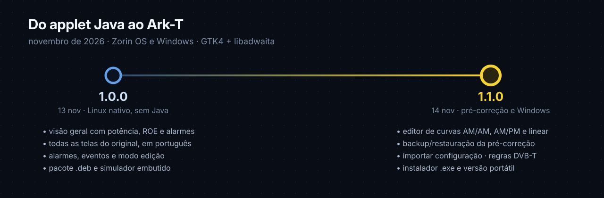
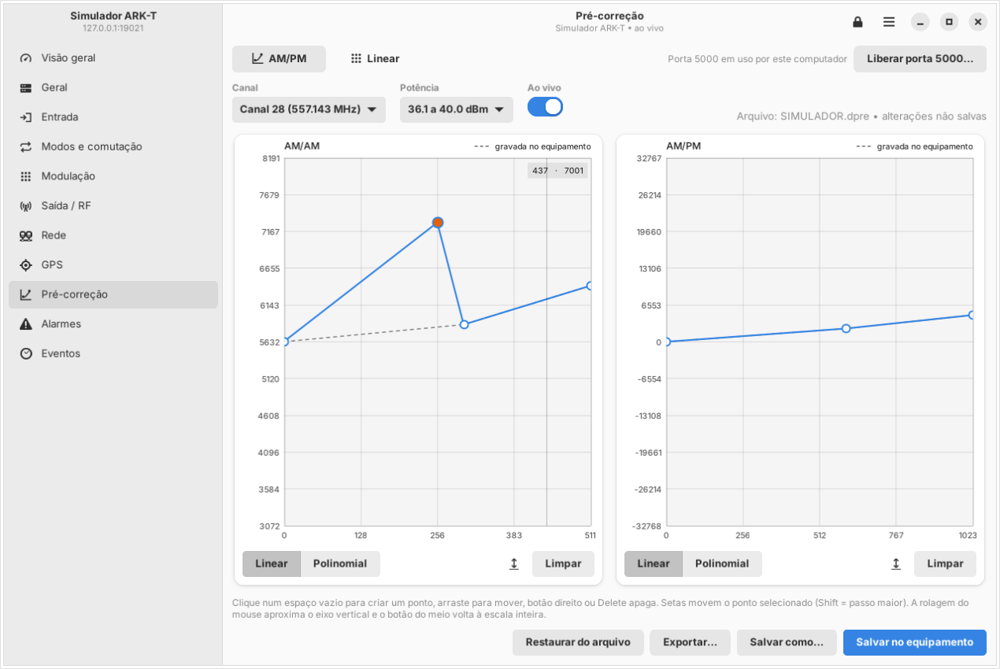
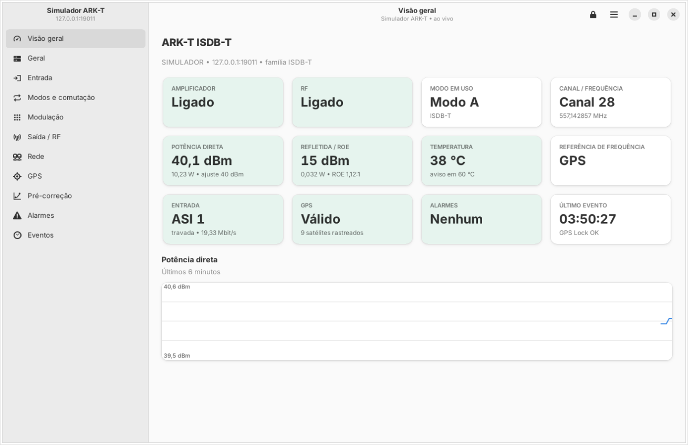

# Histórico de versões

  

Legenda:  recurso novo ·  mudança em algo que já existia ·  defeito corrigido

## 1.1.0 - 2026-11-14

**Pré-correção e Windows.** O que faltava do programa original chega: o editor de curvas da porta 5000, o backup da pré-correção e a importação de configuração. E o Ark-T passa a ter instalador para Windows.

-  **Pré-correção AM/AM e AM/PM**: login próprio (e troca de usuário e senha), escolha de canal e faixa de potência, dois editores de curva com pontos arrastáveis, modo linear ou polinomial, envio **ao vivo** enquanto arrasta, curva gravada no equipamento tracejada ao fundo, restaurar do arquivo, salvar e salvar como.
-  **Pré-correção linear**: módulo (dB) e atraso de grupo (ns) por frequência, com a **resposta que o equipamento está usando** em vermelho, lida de volta dos coeficientes.
-  **Backup da pré-correção**: baixa os arquivos `.dpre`/`.apre`/`.dlin`/`.alin` exatamente como estão no equipamento, num `.zip` com SHA-256 de cada um (e `.cdef`/`.dpwr` como referência). **Restaurar backup** devolve os arquivos ao equipamento.
-  **Importar configuração** (`.sav`), com o botão para aplicar logo em seguida.
-  **Windows**: instalador `.exe` (instala sem administrador) e versão portátil `.zip`, com Python e GTK próprios. Não precisa de Java nem de nada instalado.
-  **Telas do DVB-T com as regras dinâmicas**: o que só vale para DVB-T, analógico, modo standalone ou sistemas MEDIASET é habilitado, desabilitado ou fica em espera como no original; abas da modulação somem conforme os modos do equipamento.
-  **Nada do fabricante no repositório**: as telas são lidas do `.jar` original, que o próprio ARK-T publica — na primeira conexão o Ark-T baixa e lê sozinho (ou peça em **☰ › Importar telas do programa original**, ou `arkt importar-jar`).
-  Referência de frequência no DVB-T manda o comando prévio do registro 3, como no original.
-  Simulador com pré-correção (porta 5000, login `admin`/`admin`), troca de senha, DVB-T (`arkt simulador --dvbt`) e publicação de `.jar`.
-  O alarme "Time Slicing LP" do DVB-T aparecia com o título do HP (erro do original).
-  Testes automáticos com dados sintéticos e GitHub Actions (testes a cada push; `.deb`, instalador e portátil do Windows a cada tag).

## 1.0.0 - 2026-11-13

**Linux nativo, sem Java.** Primeira versão: substitui o ARK-T Installer Utility 5.5 (applet Java) por um programa GTK4/libadwaita.

-  **Visão geral**: amplificador, RF, modo, canal e frequência, potência direta (dBm e W) com gráfico, refletida e ROE calculada, temperatura, referência, entrada com taxa de bits, GPS, alarmes e último evento.
-  Todas as telas do original em português — Geral, Entrada, Modos e comutação, Modulação (ISDB-T e ITU), Saída / RF, Rede e GPS —, com as camadas A/B/C do ISDB-T lado a lado.
-  **Alarmes** (onde cada um é sinalizado: programa, LCD, histórico, relés, traps, desligamento de RF) e **Eventos** com filtro, busca e exportação.
-  **Modo edição** com confirmação mostrando os comandos; desliga sozinho após 15 min.
-  Salvar/recarregar configuração, exportar `.sav`, reiniciar a placa, versões e números de série.
-  Equipamentos lembrados, **simulador** embutido e pacote `.deb` com ícone no menu.
