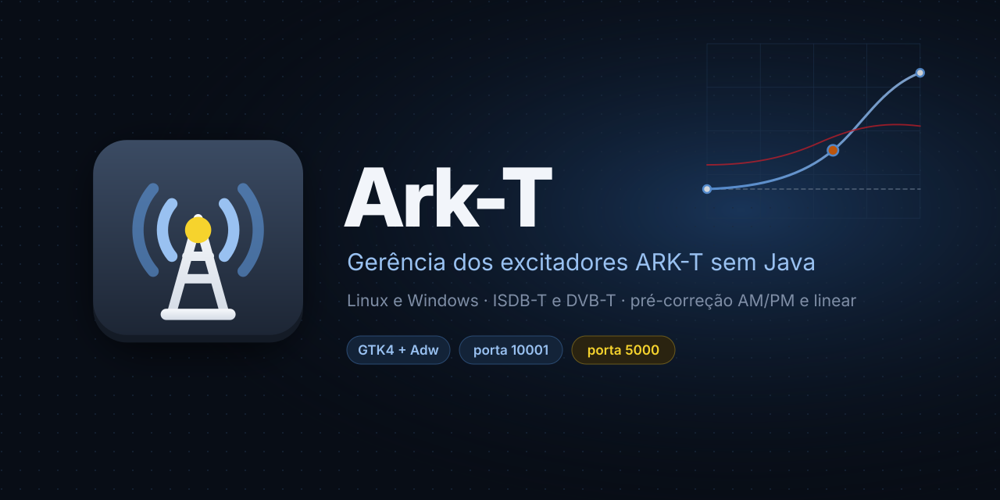
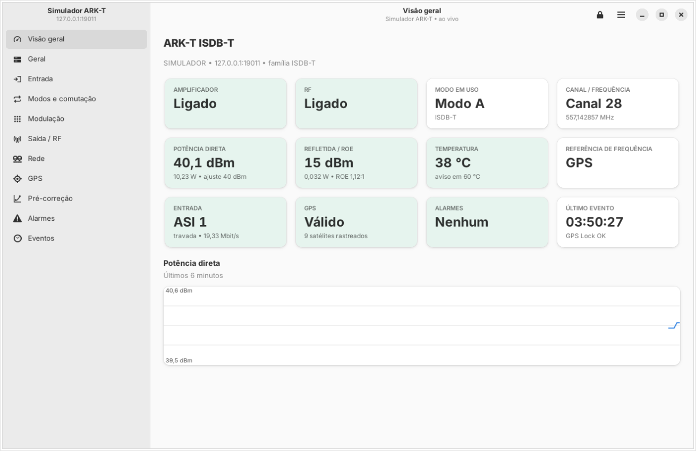
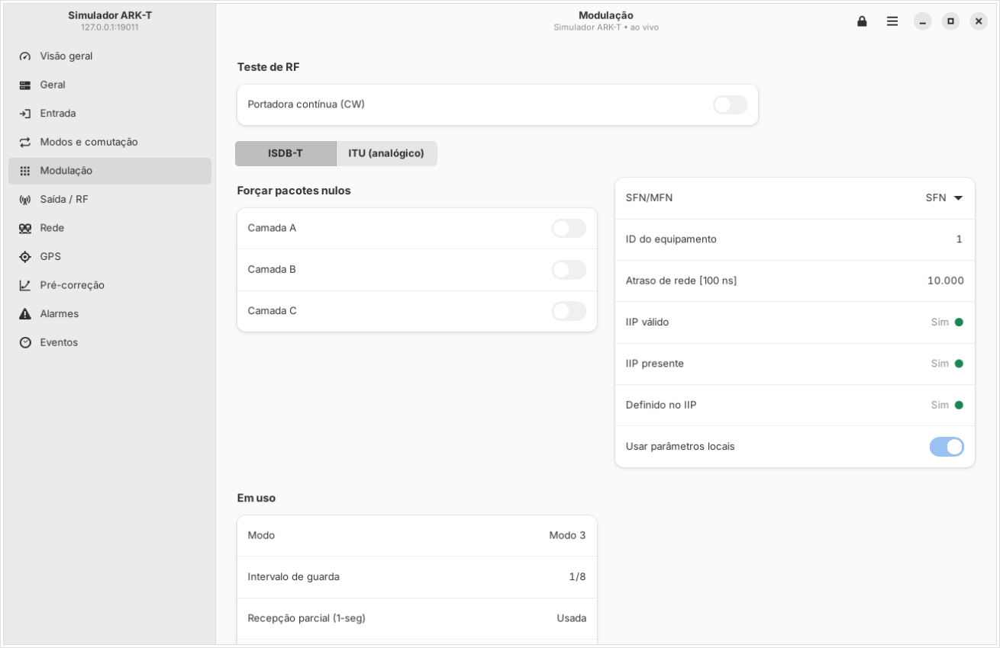
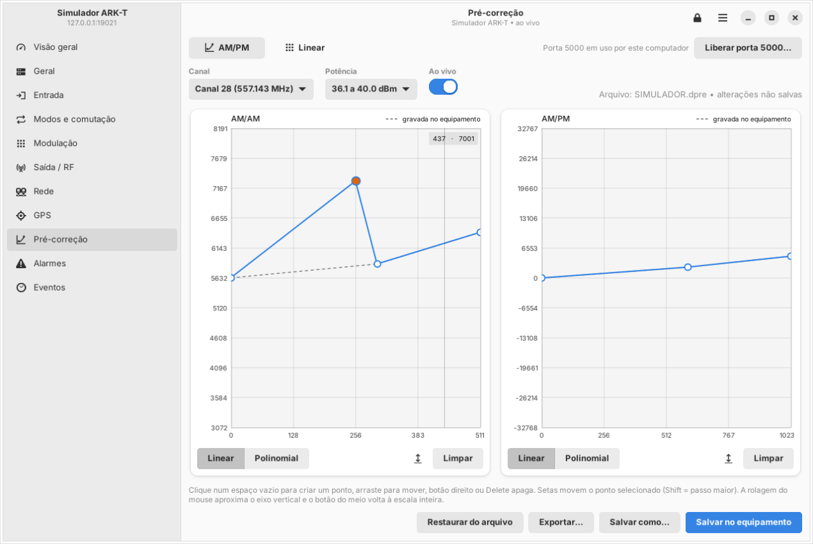
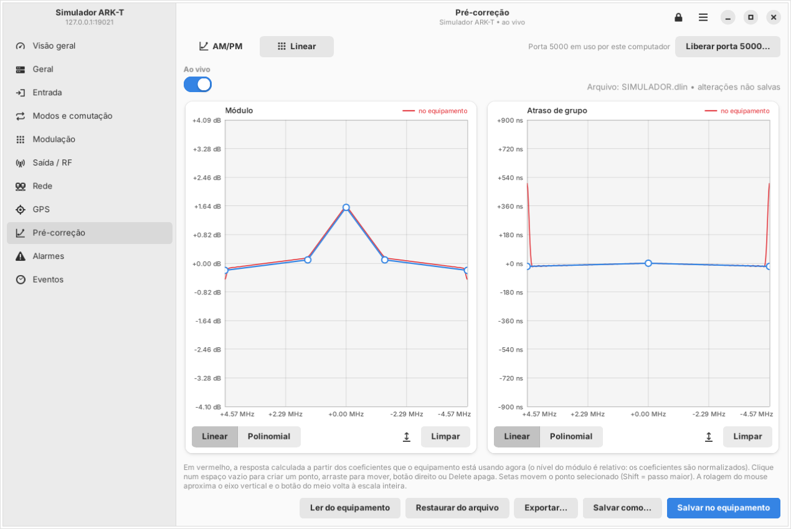
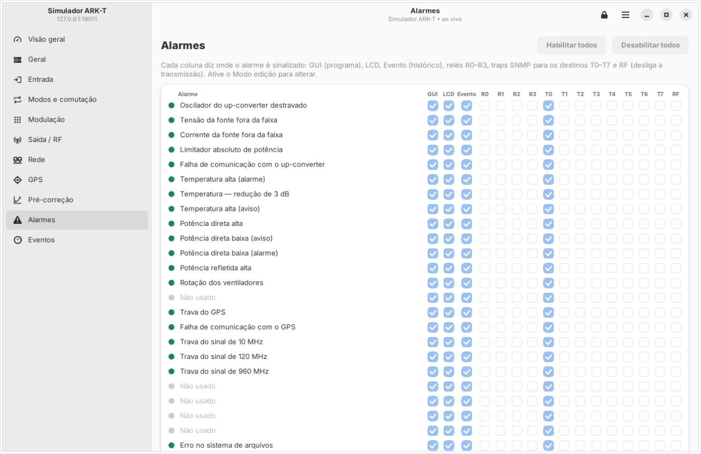
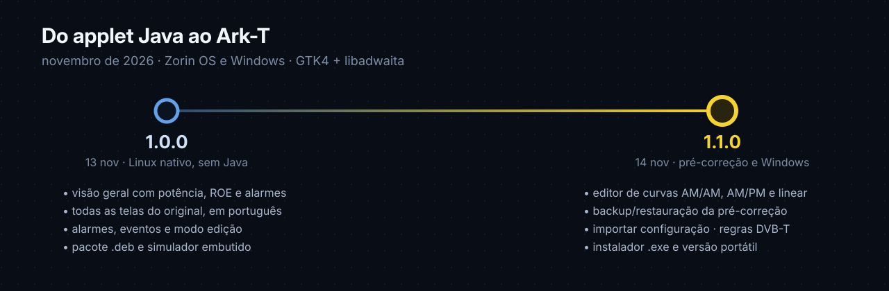

<p align="center">
  
</p>

<p align="center">
  
  
  
  
  
  
  
</p>

**Ark-T** é a gerência dos excitadores **ARK-T** (MB International / Screen Service) para **Linux e Windows**, sem Java. Substitui o *ARK-T Installer Utility 5.5*, o applet que vem com o equipamento: mostra o estado do transmissor numa visão geral, traz todas as telas de configuração em português, os alarmes e eventos, e o **editor da pré-correção AM/PM e linear**.

> O Ark-T é o primeiro app do **[Sintonia](../README.md)**, a coleção de programas nativos, sem Java, para equipamentos de transmissão.

O programa original é um applet Java de 2012. Nos computadores de hoje ele depende de um Java antigo, abre com avisos de segurança e não tem para onde evoluir. O Ark-T conversa com o excitador do mesmo jeito que ele (portas TCP 10001 e 5000 e os arquivos por HTTP), só que como um programa nativo, com modo edição, confirmação do que vai ser enviado e um simulador para treinar sem mexer no transmissor.

<p align="center">
  <br>
  <sub>Visão geral de um ARK-T ISDB-T (simulador embutido).</sub>
</p>

---

## O que ele faz

### Visão geral e telas

- **Visão geral**: amplificador, RF, modo em uso, canal e frequência, potência direta (dBm e W) com gráfico dos últimos minutos, refletida e **ROE calculada**, temperatura, referência de frequência, entrada em uso com taxa de bits, GPS, alarmes ativos e último evento.
- Todas as telas do original: **Geral, Entrada, Modos e comutação, Modulação (ISDB-T, DVB-T e ITU), Saída / RF, Rede e GPS**. As camadas A/B/C do ISDB-T aparecem lado a lado (em uso, local e IIP).
- As **regras dinâmicas** do original, para ISDB-T e DVB-T: o que depende do modo em uso (DVB-T, ISDB-T, analógico), do modo de curvas standalone, do tipo de hardware ou do sistema MEDIASET fica habilitado, desabilitado ou em espera como no programa Java.

<p align="center"></p>

### Pré-correção AM/PM e linear

A pré-correção usa a **porta 5000**, que aceita um computador por vez e tem usuário e senha próprios (dá para trocar pelo Ark-T).

- **AM/AM e AM/PM**: escolha o canal e a faixa de potência; cada curva tem pontos que você **arrasta**, cria com um clique e apaga com o botão direito, em modo linear ou polinomial. Com **Ao vivo** ligado, a curva vai para o equipamento enquanto você arrasta (como no original); desligado, só quando solta. A curva gravada no equipamento fica tracejada ao fundo para comparar.
- **Linear**: módulo (dB) e atraso de grupo (ns) ao longo do canal. Em vermelho, a **resposta que o equipamento está usando de fato**, calculada dos coeficientes lidos de volta.
- **Restaurar do arquivo** desfaz a edição e o equipamento volta à curva gravada; **Salvar no equipamento** e **Salvar como…** gravam o arquivo; **Exportar…** salva uma cópia no computador.
- Ao **liberar a porta 5000** com alterações não salvas, o Ark-T pergunta se salva ou descarta (e, ao descartar, o equipamento recarrega as curvas gravadas).

<p align="center"></p>
<p align="center"></p>

### Backup da pré-correção e configuração

- **☰ do equipamento › Baixar backup da pré-correção…** baixa os arquivos `.dpre`, `.apre`, `.dlin` e `.alin` **exatamente como estão gravados no equipamento**, num `.zip` com o SHA-256 de cada um. Os `.cdef`, `.dpwr` e `.apwr` vão junto numa pasta `referencia/`, só para consulta.
- **Restaurar backup da pré-correção…** confere o `.zip` e devolve os arquivos ao equipamento (pede o login da pré-correção).
- **Exportar configuração (.sav)** e **Importar configuração (.sav)**, com o botão para aplicar a configuração importada logo em seguida.
- Salvar e recarregar a configuração do equipamento, reiniciar a placa, versões e números de série.

### Alarmes e eventos

- **Alarmes**: estado de cada alarme e onde ele é sinalizado (programa, LCD, histórico, relés R0–R3, traps T0–T7, desligamento de RF), com "habilitar/desabilitar todos".
- **Eventos**: histórico com filtro por tipo, busca e exportação em CSV ou `.log`.

<p align="center"></p>

### Segurança na operação

- Nada é alterado sem o **Modo edição** (cadeado no alto ou `Ctrl+E`). Mudanças de canal, potência, modo, RF, referência de frequência, SFN e afins pedem confirmação mostrando os comandos que vão ser enviados. O modo edição desliga sozinho após 15 minutos parado.
- A pré-correção só abre com o login dela, e só um computador por vez entra na porta 5000.
- "Limpar" uma curva desliga o RF por cerca de 1 segundo durante a troca, como o original faz para evitar transientes — e o Ark-T avisa antes.

---

## Arquivos do fabricante

O programa original pertence à MB International / Screen Service e **não faz parte deste repositório** (veja o [`NOTICE`](NOTICE)). As telas do Ark-T são montadas a partir do `.jar` que você já tem:

| Como | Quando |
|---|---|
| **Automático** | na primeira conexão, o Ark-T baixa o `.jar` que o próprio ARK-T publica na lista de arquivos e lê a descrição das telas |
| **Menu ☰ › Importar telas do programa original (.jar)…** | se o equipamento não publicar o `.jar` (o Ark-T pede o arquivo, ex.: `arkT_v5_5s.jar`) |
| `arkt importar-jar arkT_v5_5s.jar` | pela linha de comando |

O `.jar` só é **lido** (nenhuma parte dele é executada) e a descrição fica em `~/.local/share/arkt/` no Linux ou `%APPDATA%\Ark-T\` no Windows. Isso é feito uma vez só.

---

## Instalação

### Zorin OS / Ubuntu / Debian

Precisa do Zorin OS 18 / Ubuntu 24.04 ou mais novo (GTK 4.14 e libadwaita 1.5).

**Pacote `.deb`** — baixe na página de [Releases](https://github.com/aragonxpd154/sintonia/releases):

```bash
sudo apt install ./arkt_1.1.0_all.deb
```

Depois abra o **Ark-T** pelo menu de aplicativos.

**A partir do código:**

```bash
git clone https://github.com/aragonxpd154/sintonia.git
cd sintonia/ark-t
./instalar.sh                     # ou: ./instalar.sh --jar ~/Downloads/arkT_v5_5s.jar
```

**Sem instalar:**

```bash
sudo apt install python3-gi gir1.2-gtk-4.0 gir1.2-adw-1 librsvg2-common
./arkt.sh
```

### Windows 10 e 11

Na página de [Releases](https://github.com/aragonxpd154/sintonia/releases):

- **`Ark-T-1.1.0-windows-x64-instalador.exe`** — instala em `%LOCALAPPDATA%\Programs\Ark-T`, **sem pedir administrador**, com atalho no menu Iniciar e na área de trabalho e desinstalador em *Aplicativos instalados*.
- **`Ark-T-1.1.0-windows-x64-portatil.zip`** — descompacte em qualquer pasta (ou pendrive) e abra `Ark-T.exe`.

Os dois trazem o Python e o GTK dentro: não precisa de Java nem de mais nada instalado. Ao abrir o simulador, o Firewall do Windows pode perguntar se libera as portas dele. Se o programa não abrir, `Ark-T-depuracao.bat` mostra a mensagem de erro.

---

## Uso

1. Abra o **Ark-T**, digite o IP do excitador e clique em **Conectar** (ou **Abrir simulador** para treinar).
2. Navegue pelas telas na barra lateral. Para mudar alguma coisa, ligue o **Modo edição**.
3. Para a pré-correção, abra **Pré-correção › Entrar…** com o usuário e a senha dela.

O equipamento precisa estar acessível nas portas **TCP 10001** (comandos), **80** (arquivos `.def`, `.cdef`, `.dpwr`, `.sav`…) e **5000** (pré-correção). É a mesma comunicação do programa Java: a cada 2 segundos o Ark-T abre a conexão, lê o bloco de status de 1405 bytes e fecha.

### Linha de comando

| Comando | Para quê |
|---|---|
| `arkt` | abre o programa |
| `arkt 192.168.1.50` | abre já conectado neste IP (como o `java -jar` antigo) |
| `arkt 10.0.0.5 --porta 10001 --http 80 --prec 5000` | portas diferentes do padrão |
| `arkt importar-jar arkT_v5_5s.jar` | importa as telas do programa original |
| `arkt simulador` | sobe um ARK-T ISDB-T simulado (comandos 10001, pré-correção 5000, HTTP 8080) |
| `arkt simulador --dvbt --porta 11001 --http 8081` | um ARK-T DVB-T simulado (pré-correção na porta 11002) |
| `arkt --versao` | mostra a versão |

No simulador, o login da pré-correção é `admin` / `admin`.

---

## Testes

```bash
python3 -m unittest discover -s tests -v
```

Os testes usam só dados sintéticos e o simulador: protocolo das portas 10001 e 5000, curvas e arquivos da pré-correção (`.dpre`, `.dlin`, serialização Java), coeficientes da linear e a resposta lida de volta, backup, e a importação das telas a partir de uma classe Java montada byte a byte no próprio teste. Com as telas importadas, `tests/test_modelo.py` também lê e escreve cada tipo de campo de todas as telas pelo simulador.

Os roteiros de interface em [`tests/interface`](tests/interface) abrem o programa contra o simulador (com `xvfb-run`) e salvam as telas em PNG; `teste_gui_prec.py` percorre a pré-correção inteira (login, edição, envio, salvar, backup, restauração, importar `.sav`, liberar).

## Gerar os pacotes

```bash
packaging/construir-deb.sh                  # dist/arkt_<versão>_all.deb e .sha256
packaging/windows/construir-windows.sh      # dist/Ark-T-<versão>-windows-x64-instalador.exe e -portatil.zip
```

O pacote do Windows é montado no próprio Linux: baixa (com SHA-256 conferido) o Python do [python-build-standalone](https://github.com/astral-sh/python-build-standalone) e o GTK 4 + libadwaita + PyGObject do [gvsbuild](https://github.com/wingtk/gvsbuild), escolhe só as DLLs usadas, compila o lançador `Ark-T.exe` com o mingw-w64 e gera o instalador com o NSIS. Ferramentas:

```bash
sudo apt install gcc-mingw-w64-x86-64 binutils-mingw-w64-x86-64 nsis librsvg2-bin imagemagick unzip zip
```

## Publicar uma versão nova

1. Altere `VERSAO` em `ark-t/arkt/__init__.py`, a seção da versão no [`CHANGELOG.md`](CHANGELOG.md) e o `<release>` em `packaging/io.github.aragonxpd154.ArkT.metainfo.xml`.
2. Faça o commit e crie a tag `ark-t-v<versão>` (cada app do Sintonia tem as suas):

```bash
git commit -am "Ark-T 1.1.1"
git tag ark-t-v1.1.1
git push origin main ark-t-v1.1.1
```

O GitHub Actions roda os testes, gera o `.deb`, o instalador e o portátil do Windows e cria a Release com os SHA-256.

## Estrutura

```text
sintonia/ark-t/
├── arkt/
│   ├── ui/
│   │   ├── janela.py        janela, menus, backup, importações
│   │   ├── conexao.py       tela de conexão e equipamentos lembrados
│   │   ├── visao_geral.py   visão geral (cartões e gráfico de potência)
│   │   ├── paginas.py       telas montadas da descrição importada
│   │   ├── precorrecao.py   pré-correção: login, AM/PM, linear, salvar, liberar
│   │   ├── curvas.py        editor gráfico de curvas (cairo)
│   │   ├── alarmes.py       tabela de alarmes
│   │   └── eventos.py       histórico de eventos
│   ├── protocolo.py         porta 10001 (status, comandos, eventos) e HTTP
│   ├── precorrecao.py       porta 5000, curvas, .dpre/.apre/.dlin/.alin, coeficientes
│   ├── javaser.py           serialização Java (pontos de controle dos arquivos)
│   ├── campos.py            cada tipo de componente do original: leitura e escrita
│   ├── modelo.py            telas, arquivos de definição e regras dinâmicas
│   ├── jar.py               importa as telas do .jar original (sem executá-lo)
│   ├── backup.py            backup .zip da pré-correção
│   ├── simulador.py         ARK-T simulado (ISDB-T ou DVB-T)
│   └── ...
├── tests/                   testes com dados sintéticos e roteiros de interface
├── packaging/               .deb, atalho, metadados; windows/ (lançador, NSIS, montagem)
└── assets/                  logo, banner, prints
```

## Histórico

<p align="center"></p>

As mudanças de cada versão estão no [`CHANGELOG.md`](CHANGELOG.md).

## Marcas e licença

ARK-T, MB International e Screen Service são marcas de seus donos. O Ark-T é um projeto independente, sem vínculo com esses fabricantes, e não inclui arquivos deles (veja o [`NOTICE`](NOTICE)).

Código sob a licença [MIT](../LICENSE) © Marcos Santos
